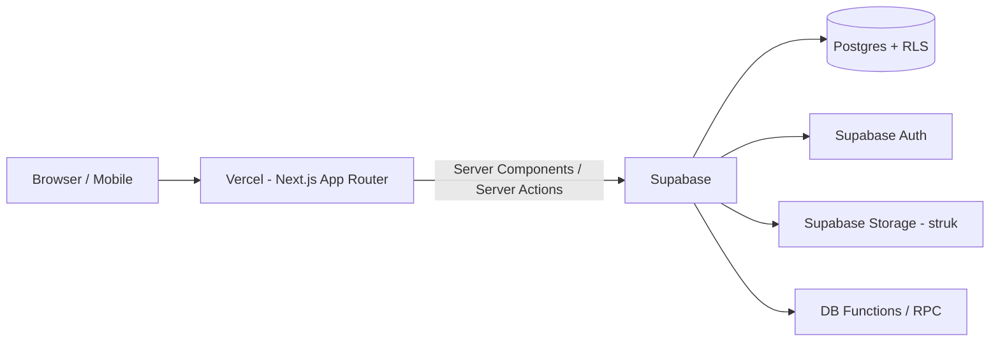

# TRD — Technical Requirement Documentation
**Produk:** RumahBahagia — Catatan Keuangan Keluarga | **Versi:** 1.0

---

## 1. Arsitektur Tingkat Tinggi


## 2. Tech Stack
| Layer | Teknologi | Alasan |
|-------|-----------|--------|
| Runtime & Package Manager | **Node.js LTS + npm** | Mesin untuk menjalankan proyek di komputer/server & mengunduh paket library; stabil dan bawaan resmi |
| UI Library & Framework | **React 19 + Next.js 15 (App Router) + TypeScript** | React untuk membangun komponen tampilan (UI); Next.js sebagai kerangka kerja full-stack yang native di Vercel |
| Styling | **Tailwind CSS v4** + CSS variables (design tokens) | Konsisten dengan Design Brief |
| UI Kit | **shadcn/ui** (Radix) | Aksesibel, mudah dikustom |
| Ikon | lucide-react | Ringan |
| Form & Validasi | react-hook-form + **zod** | Validasi shared client/server |
| Data fetching | Server Components + Server Actions; TanStack Query untuk interaksi client | |
| Grafik | Recharts | |
| Tanggal | date-fns (locale `id`) | |
| Angka | `Intl.NumberFormat('id-ID')`, penyimpanan `numeric(18,2)` | Hindari floating error |
| Backend | **Supabase** (Postgres 15, Auth, Storage, RLS, RPC) | |
| Supabase client | `@supabase/ssr` | Cookie-based session |
| Tipe DB | `supabase gen types typescript` | Type-safe |
| Ekspor PDF | `@react-pdf/renderer` | |
| Testing | Vitest, Testing Library, Playwright, pgTAP (opsional) | |
| Lint/Format | ESLint, Prettier | |
| Hosting | Vercel (Preview per PR, Production `main`) | |
| CI | GitHub Actions: lint, typecheck, test, migrasi supabase | |

## 3. Struktur Proyek
```
/app
  /(auth)/login, /register, /forgot-password
  /(app)/layout.tsx           -> sidebar + topbar
  /(app)/dashboard
  /(app)/pemasukan
  /(app)/pengeluaran
  /(app)/transfer
  /(app)/rekening
  /(app)/tabungan
  /(app)/investasi
  /(app)/aset
  /(app)/utang
  /(app)/laporan/[neraca|surplus-defisit|arus-kas|buku-besar|jurnal]
  /(app)/pengaturan/[household|anggota|kategori|profil]
  /api/export/...             -> route handler CSV/PDF
/components/ui                -> shadcn
/components/features/...      -> per modul
/lib/supabase/{client,server,middleware}.ts
/lib/validators/*.ts          -> zod schema
/lib/accounting/*.ts          -> helper format & mapping
/lib/format.ts                -> formatRupiah, formatTanggal
/supabase/migrations/*.sql
/supabase/seed.sql
/types/database.ts
middleware.ts                 -> refresh session, proteksi route
```

## 4. Desain Akuntansi Teknis
- **Chart of Accounts (COA)** per household dengan 5 tipe: `asset`, `liability`, `equity`, `income`, `expense`.
- Rekening, pos tabungan, investasi, aset, utang **masing-masing terhubung ke 1 akun COA** (`ledger_account_id`).
- Kategori pemasukan = akun `income`, kategori pengeluaran = akun `expense`.
- Transaksi dibuat melalui **RPC Postgres** (`create_transaction`) secara atomik: insert `journal_entries` + `journal_lines`, validasi debit = kredit.
- Saldo dihitung dari `journal_lines` (view `v_account_balances`), bukan disimpan manual → tidak ada drift.
- Edit transaksi = update jurnal dalam satu transaksi DB; hapus = soft delete (`voided_at`) sehingga audit tetap ada.

### Mapping Jurnal Otomatis
| Aksi UI | Debit | Kredit |
|---------|-------|--------|
| Pemasukan | Rekening (aset) | Kategori pemasukan (income) |
| Pengeluaran | Kategori pengeluaran (expense) | Rekening (aset) / Kartu kredit (liabilitas) |
| Transfer | Rekening tujuan | Rekening sumber |
| Biaya transfer | Beban Admin Bank | Rekening sumber |
| Setor tabungan | Pos tabungan (aset) | Rekening |
| Tarik tabungan | Rekening | Pos tabungan |
| Beli investasi | Investasi (aset) | Rekening |
| Jual investasi (untung) | Rekening | Investasi (pokok) + Pendapatan Investasi |
| Revaluasi investasi/aset naik | Investasi/Aset | Ekuitas: Selisih Revaluasi |
| Beli aset tunai | Aset | Rekening |
| Terima pinjaman | Rekening | Utang |
| Bayar cicilan | Utang (pokok) + Beban Bunga | Rekening |
| Saldo awal | Rekening/Aset | Ekuitas: Saldo Awal |
| Penyesuaian rekonsiliasi | Rekening / Beban Selisih | Pendapatan Selisih / Rekening |

## 5. Keamanan
- **RLS aktif di semua tabel**; akses berdasarkan `household_members` (fungsi `is_member(household_id)`, `has_role(household_id, role)`).
- Server Actions memverifikasi session via `supabase.auth.getUser()`.
- `service_role` key hanya di server (tidak pernah `NEXT_PUBLIC_`).
- Storage bucket `receipts` privat, path `{household_id}/{transaction_id}/file`, policy berdasarkan membership.
- Validasi input zod di client & server; constraint di DB (CHECK, FK).
- Rate limiting undangan (Supabase / Vercel middleware).

## 6. Environment Variables
| Nama | Scope |
|------|-------|
| `NEXT_PUBLIC_SUPABASE_URL` | public |
| `NEXT_PUBLIC_SUPABASE_ANON_KEY` | public |
| `SUPABASE_SERVICE_ROLE_KEY` | server only |
| `NEXT_PUBLIC_SITE_URL` | public (redirect auth) |

## 7. Performa
- Index pada `journal_lines(account_id)`, `journal_entries(household_id, entry_date)`.
- Laporan berat memakai SQL function / view dengan filter periode.
- RSC streaming + `loading.tsx` skeleton.
- Paginasi berbasis cursor (`entry_date, id`).

## 8. Deployment & Environment
| Env | Branch | Supabase Project |
|-----|--------|------------------|
| Local | - | `supabase start` (Docker) |
| Preview | PR | staging |
| Production | `main` | production |

Migrasi: `supabase db push` via GitHub Action sebelum deploy Vercel production.

## 9. Observability
- Vercel Analytics & Speed Insights.
- Sentry (opsional) untuk error client/server.
- Supabase logs untuk query lambat.

## 10. Backup
- Supabase daily backup (plan Pro) / PITR.
- Fitur ekspor CSV seluruh data untuk pengguna.

## 11. Browser Support
Chrome, Edge, Firefox, Safari — 2 versi terakhir; iOS Safari 16+, Android Chrome.
