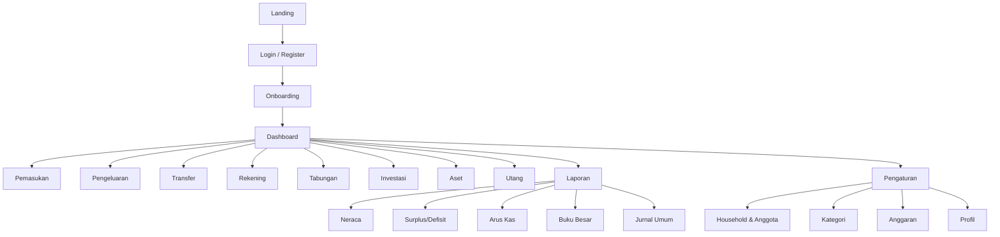
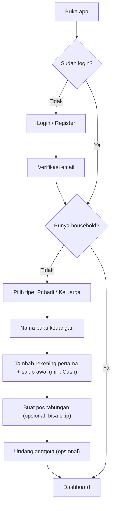
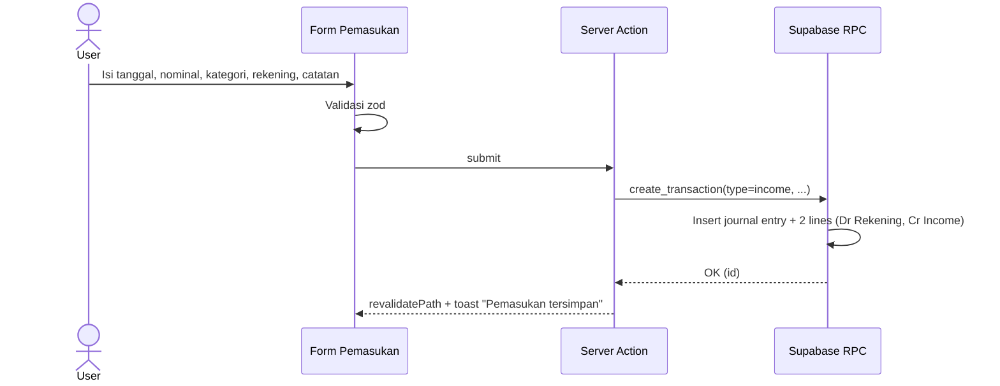
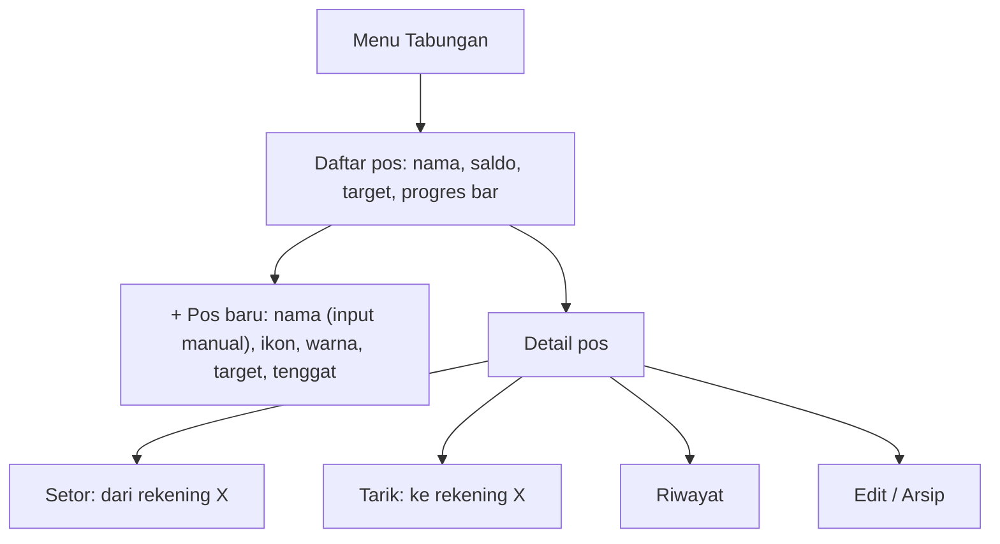

# AFD — App Flow Documentation
**Produk:** RumahBahagia — Catatan Keuangan Keluarga | **Versi:** 1.0

---

## 1. Sitemap

## 2. Navigasi
- **Desktop:** Sidebar kiri (Dashboard, Pemasukan, Pengeluaran, Transfer, Rekening, Tabungan, Investasi, Aset, Utang, Laporan, Pengaturan) + topbar (switch household, pilih periode, avatar).
- **Mobile:** Bottom nav 5 item: Dashboard, Transaksi, **(+) FAB**, Tabungan, Lainnya. FAB membuka sheet: Pemasukan / Pengeluaran / Transfer / Setor Tabungan.

## 3. Flow Autentikasi & Onboarding

Saat household dibuat, sistem otomatis men-seed COA & kategori default.

## 4. Flow Undangan Anggota
1. Owner → Pengaturan → Anggota → "Undang" → isi email + peran.
2. Sistem membuat `household_invitations` (token, kadaluarsa 7 hari) & mengirim email.
3. Penerima klik link → login/register → `accept_invitation(token)` → masuk ke household.

## 5. Flow Pemasukan

## 6. Flow Pengeluaran
1. Isi: tanggal, nominal, kategori (+ sub), rekening sumber, catatan, foto struk (opsional).
2. Jika saldo rekening < nominal → peringatan (bukan blokir; kecuali pengaturan "larang saldo minus").
3. Upload struk ke Storage → simpan path.
4. RPC membuat jurnal: Dr Beban, Cr Rekening.
5. Jika anggaran kategori > 80% → toast peringatan.

## 7. Flow Transfer
Pilih rekening asal → rekening tujuan (tidak boleh sama) → nominal → biaya admin (opsional) → simpan. Jurnal: Dr Tujuan, Cr Asal; Dr Beban Admin, Cr Asal.

## 8. Flow Tabungan

Contoh pos default (bisa dihapus): Dana Darurat, Pendidikan, Hari Tua.
> Pos tabungan bisa ditautkan ke rekening fisik (mis. "Bank Jago - Kantong Darurat") sebagai info, namun saldo tetap dilacak sebagai akun alokasi.

## 9. Flow Investasi
1. Tambah instrumen: jenis, nama (mis. "RDPU Sucor"), platform, catatan.
2. Transaksi: **Beli** (unit, harga, biaya, dari rekening), **Jual** (unit, harga, ke rekening → hitung realized gain/loss metode rata-rata), **Dividen/Bunga** (ke rekening).
3. **Update nilai pasar** (harga per unit / total nilai) → jurnal revaluasi.
4. Tampilan: nilai pokok, nilai pasar, untung/rugi (Rp & %), alokasi pie chart.

## 10. Flow Aset
1. Tambah aset: nama, kategori, tanggal perolehan, nilai perolehan, sumber dana (rekening / utang / saldo awal / hadiah).
2. Revaluasi: input nilai sekarang → jurnal selisih.
3. Penyusutan (opsional): metode garis lurus, umur ekonomis → jurnal bulanan otomatis (fase 2).
4. Jual/lepas aset: harga jual, ke rekening → laba/rugi pelepasan.

## 11. Flow Utang
Tambah utang (nama, pemberi, pokok, bunga, tenor, tanggal mulai, dana masuk ke rekening/aset) → Bayar cicilan (pokok, bunga, dari rekening) → progres pelunasan.

## 12. Flow Rekening
- Daftar dikelompokkan per jenis (Cash, Bank, E-Wallet, Kartu Kredit) dengan total.
- Detail: saldo, mutasi (buku besar), tombol **Rekonsiliasi** (input saldo riil → jurnal penyesuaian).
- Arsip hanya jika saldo = 0.

## 13. Flow Laporan
Pilih laporan → pilih periode (bulan ini, bulan lalu, tahun ini, custom) → tampil → ekspor CSV/PDF. Klik baris akun → drill-down ke Buku Besar → klik transaksi → detail jurnal.

## 14. Flow Edit / Hapus Transaksi
- Edit: buka detail → ubah → RPC `update_transaction` (ganti lines atomik) → audit log.
- Hapus: konfirmasi dialog → `void_transaction` (soft delete). Viewer tidak melihat tombol ini.

## 15. State & Error Handling
| Kondisi | Perilaku UI |
|---------|-------------|
| Loading | Skeleton |
| Kosong | Empty state ilustrasi + CTA ("Tambah rekening pertama") |
| Error jaringan | Toast merah + tombol coba lagi |
| Validasi | Pesan di bawah field |
| Tidak berhak | Halaman 403 / tombol disembunyikan |
| Session habis | Redirect ke login dengan `?next=` |
