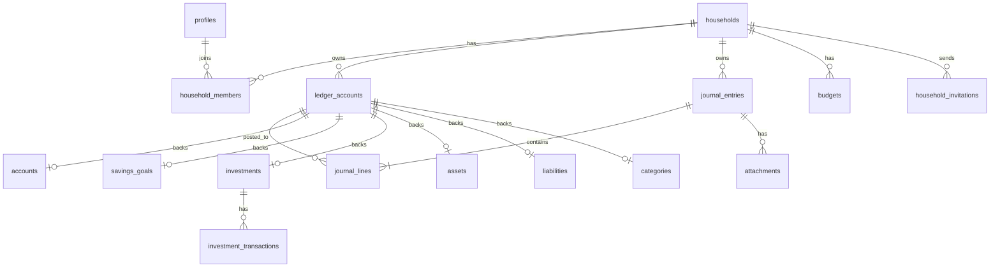

# BSD — Backend Schema Documentation
**Produk:** RumahBahagia — Catatan Keuangan Keluarga | **Database:** Supabase Postgres | **Versi:** 1.0

---

## 1. Prinsip
- Multi-tenant per **household**; setiap tabel bisnis punya `household_id`.
- **Double-entry**: semua nilai uang tercatat di `journal_lines`. Tabel modul (rekening, tabungan, dll.) adalah *metadata* yang menunjuk ke `ledger_accounts`.
- Nominal `numeric(18,2)`, semua PK `uuid default gen_random_uuid()`, timestamp `timestamptz`.
- Soft delete via `archived_at` (master) / `voided_at` (jurnal).

## 2. ERD


## 3. Enum
```sql
create type member_role      as enum ('owner','editor','viewer');
create type household_type   as enum ('personal','family');
create type account_class    as enum ('asset','liability','equity','income','expense');
create type cash_account_type as enum ('cash','bank','ewallet','credit_card');
create type txn_type as enum (
  'income','expense','transfer','saving_deposit','saving_withdraw',
  'investment_buy','investment_sell','investment_dividend','revaluation',
  'asset_purchase','asset_disposal','liability_drawdown','liability_payment',
  'opening_balance','adjustment','manual_journal'
);
create type investment_type  as enum ('mutual_fund','stock','gold','bond','deposit','crypto','other');
create type asset_category   as enum ('property','vehicle','electronics','land','jewelry','other');
create type liability_type   as enum ('mortgage','vehicle_loan','personal_loan','credit_card','paylater','other');
```

## 4. Tabel

### 4.1 Identitas & Tenant
**profiles**
| Kolom | Tipe | Ket |
|---|---|---|
| id | uuid PK → auth.users.id | |
| full_name | text | |
| avatar_url | text | |
| default_household_id | uuid FK households | |
| created_at | timestamptz | |

**households**
| Kolom | Tipe | Ket |
|---|---|---|
| id | uuid PK | |
| name | text not null | "Keluarga Budi" |
| type | household_type | |
| currency | char(3) default 'IDR' | |
| allow_negative_balance | bool default true | |
| created_by | uuid FK profiles | |
| created_at | timestamptz | |

**household_members** — PK (household_id, user_id), `role member_role`, `joined_at`.

**household_invitations** — id, household_id, email, role, token (unique), invited_by, expires_at, accepted_at.

### 4.2 Inti Akuntansi
**ledger_accounts** (Chart of Accounts)
| Kolom | Tipe | Ket |
|---|---|---|
| id | uuid PK | |
| household_id | uuid FK | |
| code | text | mis. `1-1001` |
| name | text | |
| class | account_class | |
| parent_id | uuid FK self | hierarki |
| is_system | bool | akun bawaan tidak boleh dihapus |
| archived_at | timestamptz | |
| unique(household_id, code) | | |

**COA default (seed saat household dibuat)**
| Kode | Nama | Class |
|---|---|---|
| 1-0000 | Aset | asset |
| 1-1000 | Kas & Bank | asset |
| 1-2000 | Tabungan Terencana | asset |
| 1-3000 | Investasi | asset |
| 1-4000 | Aset Tetap | asset |
| 1-5000 | Piutang | asset |
| 2-0000 | Liabilitas | liability |
| 2-1000 | Kartu Kredit | liability |
| 2-2000 | Pinjaman | liability |
| 3-1000 | Ekuitas Saldo Awal | equity |
| 3-2000 | Selisih Revaluasi | equity |
| 4-0000 | Pendapatan (Gaji, Bonus, Usaha, Hadiah, Pendapatan Investasi, Lain-lain) | income |
| 5-0000 | Beban (Makan, Transportasi, Tagihan, Pendidikan, Kesehatan, Belanja RT, Hiburan, Sosial/Zakat, Admin Bank, Bunga, Lain-lain) | expense |

**journal_entries**
| Kolom | Tipe | Ket |
|---|---|---|
| id | uuid PK | |
| household_id | uuid FK | |
| entry_date | date not null | |
| type | txn_type | |
| description | text | |
| reference_type | text | 'investment','asset','liability','savings_goal' |
| reference_id | uuid | id objek terkait |
| tags | text[] | |
| created_by / updated_by | uuid FK profiles | |
| created_at / updated_at | timestamptz | |
| voided_at | timestamptz | soft delete |

**journal_lines**
| Kolom | Tipe | Ket |
|---|---|---|
| id | uuid PK | |
| entry_id | uuid FK journal_entries on delete cascade | |
| household_id | uuid FK | denormalisasi untuk RLS/index |
| account_id | uuid FK ledger_accounts | |
| debit | numeric(18,2) default 0 check ≥ 0 | |
| credit | numeric(18,2) default 0 check ≥ 0 | |
| memo | text | |
| check ((debit = 0) <> (credit = 0)) | | salah satu saja terisi |

**Constraint keseimbangan** — constraint trigger `DEFERRABLE INITIALLY DEFERRED` pada `journal_lines` memastikan `sum(debit) = sum(credit)` per `entry_id` dan minimal 2 baris.

### 4.3 Modul
**accounts** (Rekening & Cash)
| Kolom | Tipe |
|---|---|
| id, household_id | uuid |
| ledger_account_id | uuid FK unique |
| name | text ("BCA Tahapan", "Dompet Ayah") |
| type | cash_account_type |
| institution | text |
| account_number_last4 | text |
| owner_member_id | uuid FK profiles (opsional) |
| color, icon | text |
| credit_limit | numeric(18,2) (kartu kredit) |
| sort_order | int |
| archived_at | timestamptz |

> `credit_card` → ledger class `liability`; lainnya `asset`.

**categories**
| Kolom | Tipe |
|---|---|
| id, household_id | uuid |
| ledger_account_id | uuid FK unique |
| name, icon, color | text |
| kind | text check in ('income','expense') |
| parent_id | uuid FK self |
| archived_at | timestamptz |

**savings_goals** (Pos Tabungan)
| Kolom | Tipe |
|---|---|
| id, household_id, ledger_account_id | uuid |
| name | text (input manual) |
| description, icon, color | text |
| target_amount | numeric(18,2) |
| target_date | date |
| linked_account_id | uuid FK accounts (opsional, info lokasi fisik) |
| archived_at | timestamptz |

**investments**
| Kolom | Tipe |
|---|---|
| id, household_id, ledger_account_id | uuid |
| name, platform, ticker | text |
| type | investment_type |
| units | numeric(24,8) |
| avg_cost | numeric(18,4) |
| market_price | numeric(18,4) |
| market_value | numeric(18,2) |
| market_updated_at | timestamptz |
| archived_at | timestamptz |

**investment_transactions** — id, investment_id, entry_id FK journal_entries, kind ('buy','sell','dividend','revalue'), units, price, fee, amount, realized_gain.

**assets**
| Kolom | Tipe |
|---|---|
| id, household_id, ledger_account_id | uuid |
| name | text |
| category | asset_category |
| acquired_date | date |
| acquisition_cost | numeric(18,2) |
| current_value | numeric(18,2) |
| depreciation_method | text ('none','straight_line') |
| useful_life_months | int |
| disposed_at | date |
| notes | text |

**liabilities**
| Kolom | Tipe |
|---|---|
| id, household_id, ledger_account_id | uuid |
| name, lender | text |
| type | liability_type |
| principal | numeric(18,2) |
| interest_rate | numeric(6,3) |
| tenor_months | int |
| start_date, due_day | date / int |
| installment_amount | numeric(18,2) |
| closed_at | date |

**budgets** — id, household_id, category_id, period_month (date, tgl 1), amount; unique(household_id, category_id, period_month).

**recurring_templates** (fase 2) — id, household_id, payload jsonb, rrule text, next_run date, active bool.

**attachments** — id, household_id, entry_id, storage_path, mime_type, size, uploaded_by.

**audit_logs** — id, household_id, actor_id, table_name, row_id, action, old_data jsonb, new_data jsonb, created_at (diisi trigger).

## 5. View
```sql
-- Saldo per akun (natural sign)
create view v_account_balances with (security_invoker = true) as
select la.id as account_id, la.household_id, la.class,
       coalesce(sum(case when la.class in ('asset','expense')
                         then jl.debit - jl.credit
                         else jl.credit - jl.debit end),0) as balance
from ledger_accounts la
left join journal_lines jl on jl.account_id = la.id
left join journal_entries je on je.id = jl.entry_id and je.voided_at is null
where jl.id is null or je.id is not null
group by la.id;
```
View lain: `v_transactions_list` (gabungan entry + akun utama + kategori untuk daftar UI), `v_savings_progress`, `v_monthly_income_expense`, `v_net_worth`.

## 6. Fungsi RPC (security definer + cek membership)
| Fungsi | Deskripsi |
|---|---|
| `create_household(name, type)` | Buat household, member owner, seed COA & kategori |
| `create_transaction(p_household, p_type, p_date, p_desc, p_lines jsonb, p_ref_type, p_ref_id)` | Insert entry + lines atomik, validasi seimbang |
| `record_income(household, date, amount, category_id, account_id, note)` | Wrapper |
| `record_expense(...)` / `record_transfer(...)` | Wrapper |
| `saving_deposit(goal_id, account_id, amount, date)` / `saving_withdraw(...)` | |
| `investment_buy / investment_sell / investment_dividend / investment_revalue` | Update units, avg_cost, realized gain |
| `asset_create(..., funding_account_id)` / `asset_revalue` / `asset_dispose` | |
| `liability_create / liability_pay(principal, interest, account_id)` | |
| `create_cash_account(household, name, type, opening_balance, ...)` | Buat ledger account + account + jurnal saldo awal |
| `reconcile_account(account_id, actual_balance, date)` | Jurnal penyesuaian |
| `update_transaction(entry_id, ...)` / `void_transaction(entry_id)` | |
| `report_balance_sheet(household, as_of)` | Neraca |
| `report_income_statement(household, from, to)` | Surplus/Defisit |
| `report_cash_flow(household, from, to)` | Arus kas (akun 1-1000 & anak) |
| `report_general_ledger(account_id, from, to)` | Buku besar + saldo berjalan |
| `accept_invitation(token)` | |

## 7. Row Level Security
```sql
create function is_member(h uuid) returns boolean
language sql stable security definer set search_path = public as $$
  select exists(select 1 from household_members
                where household_id = h and user_id = auth.uid());
$$;

create function can_edit(h uuid) returns boolean
language sql stable security definer set search_path = public as $$
  select exists(select 1 from household_members
                where household_id = h and user_id = auth.uid()
                  and role in ('owner','editor'));
$$;
```
| Tabel | SELECT | INSERT/UPDATE | DELETE |
|---|---|---|---|
| households | is_member(id) | owner | owner |
| household_members | is_member | owner | owner (atau diri sendiri keluar) |
| semua tabel bisnis | is_member(household_id) | can_edit(household_id) | owner |
| journal_* | is_member | via RPC saja (tidak ada policy insert langsung) | - |
| audit_logs | owner | trigger only | - |

Storage `receipts`: `(storage.foldername(name))[1]::uuid` harus `is_member`.

## 8. Index
```sql
create index on journal_entries (household_id, entry_date desc) where voided_at is null;
create index on journal_lines (account_id);
create index on journal_lines (household_id);
create index on ledger_accounts (household_id, class);
create index on household_members (user_id);
```

## 9. Trigger
- `on_auth_user_created` → insert `profiles`.
- `trg_balance_check` (deferred) di `journal_lines`.
- `trg_updated_at` di semua tabel.
- `trg_audit` di `journal_entries`, `accounts`, `savings_goals`, `investments`, `assets`, `liabilities`.

## 10. Contoh Jurnal
Bayar listrik Rp 450.000 dari BCA:
| Akun | Debit | Kredit |
|---|---|---|
| 5-0300 Beban Tagihan Listrik | 450.000 | |
| 1-1002 BCA Tahapan | | 450.000 |

Setor Dana Darurat Rp 1.000.000 dari BCA:
| Akun | Debit | Kredit |
|---|---|---|
| 1-2001 Tabungan Dana Darurat | 1.000.000 | |
| 1-1002 BCA Tahapan | | 1.000.000 |
