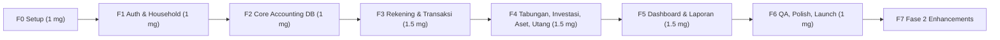

# IPD — Implementation Plan Documentation
**Produk:** RumahBahagia — Catatan Keuangan Keluarga | **Versi:** 1.0
**Estimasi total MVP:** ± 8–9 minggu (1 developer full-stack)

---

## 1. Ringkasan Fase

## 2. Detail Tahapan

### F0 — Setup Proyek (Minggu 1)
- [ ] Repo GitHub + `create-next-app` (TS, App Router, Tailwind v4, ESLint).
- [ ] Install shadcn/ui, lucide-react, zod, react-hook-form, date-fns, recharts, `@supabase/ssr`.
- [ ] Setup font (`next/font/google`: Archivo Narrow, Comfortaa, Maitree) & design tokens (lihat DBD §10).
- [ ] Supabase CLI: `supabase init`, `supabase start` lokal; buat project staging & production.
- [ ] Hubungkan Vercel ke repo, set env vars, Preview Deployments.
- [ ] GitHub Actions: lint, typecheck, test.
- [ ] Layout shell: sidebar, topbar, bottom-nav mobile, halaman kosong per menu.
- **Deliverable:** App shell ter-deploy di Vercel preview.

### F1 — Auth & Household (Minggu 2)
- [ ] Migrasi: `profiles`, `households`, `household_members`, `household_invitations`, enum.
- [ ] Trigger `on_auth_user_created`.
- [ ] Helper `is_member`, `can_edit` + RLS.
- [ ] Halaman login/register/forgot password, Google OAuth, middleware proteksi route.
- [ ] Onboarding wizard (tipe household, nama).
- [ ] Household switcher, halaman anggota & undangan + `accept_invitation`.
- **Deliverable:** User bisa daftar, membuat household, mengundang anggota.

### F2 — Core Accounting (Minggu 3)
- [ ] Migrasi `ledger_accounts`, `journal_entries`, `journal_lines`, trigger balance check.
- [ ] RPC `create_household` + seed COA & kategori default.
- [ ] RPC generik `create_transaction`, `update_transaction`, `void_transaction`.
- [ ] View `v_account_balances`.
- [ ] Test SQL (pgTAP / script): jurnal tidak seimbang ditolak, RLS antar household terisolasi.
- [ ] Generate types `types/database.ts`.
- **Deliverable:** Mesin jurnal teruji.

### F3 — Rekening & Transaksi Harian (Minggu 4–5)
- [ ] Migrasi `accounts`, `categories`, `attachments`, bucket `receipts`.
- [ ] RPC `create_cash_account` (dengan saldo awal), `record_income`, `record_expense`, `record_transfer`, `reconcile_account`.
- [ ] Halaman Rekening: daftar per jenis, detail + mutasi, form tambah/edit, arsip, rekonsiliasi.
- [ ] Halaman Pemasukan & Pengeluaran: list (filter tanggal/kategori/rekening, cari), form (sheet/dialog), input nominal Rupiah, upload struk.
- [ ] Halaman Transfer.
- [ ] FAB quick-add mobile.
- [ ] Pengaturan Kategori (CRUD, sub-kategori).
- **Deliverable:** Pencatatan harian lengkap & saldo akurat.

### F4 — Tabungan, Investasi, Aset, Utang (Minggu 5–6)
- [ ] Tabungan: migrasi `savings_goals`, RPC deposit/withdraw, halaman kartu pos + progress, detail riwayat. Pos dibuat manual oleh user.
- [ ] Investasi: migrasi `investments`, `investment_transactions`; RPC buy/sell/dividend/revalue (metode average cost); halaman portofolio + pie alokasi.
- [ ] Aset: migrasi `assets`; RPC create/revalue/dispose; halaman daftar & detail.
- [ ] Utang: migrasi `liabilities`; RPC create/pay; progres pelunasan.
- **Deliverable:** Seluruh komponen neraca tercatat.

### F5 — Dashboard & Laporan (Minggu 7–8)
- [ ] Dashboard: kartu Kekayaan Bersih, total kas, pemasukan vs pengeluaran bulan ini (bar chart), top kategori pengeluaran (donut), progres tabungan, transaksi terakhir.
- [ ] RPC laporan: neraca, surplus/defisit, arus kas, buku besar.
- [ ] Halaman Laporan + pemilih periode + drill-down.
- [ ] Jurnal Umum (mode akuntan) & form jurnal manual (owner only).
- [ ] Ekspor CSV (route handler) & PDF.
- [ ] Anggaran bulanan + indikator (Should).
- **Deliverable:** Laporan keuangan ala perusahaan.

### F6 — QA, Polish & Launch (Minggu 9)
- [ ] Unit test validator & formatter (Vitest).
- [ ] E2E Playwright: onboarding, pemasukan, pengeluaran, transfer, tabungan, neraca seimbang.
- [ ] Audit aksesibilitas & Lighthouse (target ≥ 90).
- [ ] Empty states, skeleton, error boundary, halaman 404/403.
- [ ] Audit log trigger.
- [ ] Review RLS & keamanan (Supabase Advisor).
- [ ] Migrasi ke production, domain kustom, launch.

### F7 — Fase 2
- Transaksi berulang (Vercel Cron → RPC `run_recurring`).
- Penyusutan aset otomatis bulanan (cron).
- PWA (installable, offline read).
- Dark mode, notifikasi anggaran/jatuh tempo via email.
- Harga investasi otomatis, OCR struk, multi-currency.

## 3. Definition of Done (per fitur)
1. Migrasi SQL + RLS + test.
2. Tipe TS ter-generate ulang.
3. Validasi zod client & server.
4. UI responsif, sesuai design tokens, state loading/empty/error.
5. Lolos lint, typecheck, test CI.
6. Ter-deploy di preview & diverifikasi.

## 4. Konvensi
- Branch: `feat/<modul>`, `fix/<isu>`; Conventional Commits.
- Migrasi: `supabase/migrations/YYYYMMDDHHMMSS_<nama>.sql`, tidak pernah edit migrasi yang sudah di-push.
- Nama file komponen kebab-case; komponen PascalCase.
- Semua uang diproses sebagai string/`numeric` di DB; di client gunakan integer rupiah (tanpa desimal) atau library decimal bila perlu.

## 5. Risiko Implementasi
| Risiko | Dampak | Mitigasi |
|---|---|---|
| Kompleksitas double-entry | Bug saldo | Semua tulis via RPC + trigger keseimbangan + test |
| RLS salah konfigurasi | Kebocoran data | Test isolasi 2 household, Supabase Advisor |
| Laporan lambat saat data besar | UX | Index, function SQL, materialized view bila perlu |
| Scope creep | Mundur jadwal | Patuh prioritas MoSCoW di PRD |

## 6. Checklist Go-Live
- [ ] Env production di Vercel benar, service role tidak terekspos.
- [ ] Auth redirect URL production terdaftar di Supabase.
- [ ] SMTP kustom untuk email (undangan, reset).
- [ ] Backup aktif.
- [ ] Kebijakan privasi & syarat layanan.
