# IPD — Implementation Plan Documentation
**Produk:** RumahBahagia — Catatan Keuangan Keluarga | **Versi:** 1.0  
**Status:** `[ ]` belum · `[/]` dikerjakan · `[x]` selesai | **Package manager:** `npm`  
**Estimasi total MVP:** ± 8–9 minggu (1 developer full-stack)

---

## 1. Ringkasan Fase

```mermaid
flowchart LR
  P["0 Persiapan"] --> F0["F0 Setup (1 mg)"]
  F0 --> F1["F1 Auth & Household (1 mg)"]
  F1 --> F2["F2 Core Accounting DB (1 mg)"]
  F2 --> F3["F3 Rekening & Transaksi (1.5 mg)"]
  F3 --> F4["F4 Tabungan, Investasi, Aset, Utang (1.5 mg)"]
  F4 --> F5["F5 Dashboard & Laporan (1.5 mg)"]
  F5 --> F6["F6 QA, Polish, Launch (1 mg)"]
  F6 --> F7["F7 Fase 2 Enhancements"]
```

---

## 2. Detail Tahapan & Checklist Pengerjaan

### 0. Persiapan (oleh Anda)
- [x] Install **Node.js LTS** (`v24.16.0` terverifikasi) & **npm** (`v11.13.0` terverifikasi)
- [x] Install **Git** & buat akun/repo **GitHub** (`https://github.com/agirahmawandi/RumahBahagia.git`)
- [x] Buat akun **Supabase** → project `rumahbahagia` (region Singapore), simpan URL, anon key, service role key, DB password, & access token
- [x] Buat akun **Vercel** → hubungkan repo GitHub & pasang environment variables Supabase
- [x] (Opsional) Install **Docker Desktop** untuk Supabase lokal

---

### 1. F0 — Setup Proyek (Minggu 1)
- [x] Inisialisasi Next.js 15 + TypeScript + Tailwind v4 + ESLint
- [x] Install shadcn/ui (`components.json`), lucide-react, zod, react-hook-form, date-fns, recharts, @supabase/ssr, sonner
- [x] Setup font: Archivo Narrow, Comfortaa, Maitree (`next/font/google` di `app/layout.tsx`)
- [x] Design tokens warna Tropical Heat di `app/globals.css`
- [x] Komponen UI inti: Button, Card, Badge, Input, NominalInput, Table, Skeleton, Progress, EmptyState
- [x] Helper `formatRupiah`, `formatTanggal`, `formatNominalInput`, `parseNominalInput` di `lib/format.ts`
- [x] Supabase client (`client.ts`, `server.ts`, `middleware.ts`), `middleware.ts` root, dan `.env.local` aman
- [x] Layout: sidebar desktop (248px), topbar switcher, bottom-nav + FAB mobile (`app-shell.tsx`)
- [x] Halaman skeleton seluruh menu: Dashboard, Pemasukan, Pengeluaran, Transfer, Rekening, Tabungan, Investasi, Aset, Utang, Laporan, Pengaturan, Onboarding, Login, Register, Forgot Password
- [x] Supabase local config (`supabase/config.toml`, `supabase/seed.sql`) & GitHub Actions CI (`.github/workflows/ci.yml`)
- [x] Push commit awal F0 ke GitHub & terhubung ke Vercel
- **Deliverable:** App shell ter-deploy di Vercel preview.

---

### 2. F1 — Auth & Household (Minggu 2)
- [x] Migrasi SQL: enum, `profiles`, `households`, `household_members`, `household_invitations` (`20261029000001_f1_auth_and_household.sql`)
- [x] Trigger buat profil saat user daftar (`on_auth_user_created`)
- [x] Helper RLS `is_member`, `can_edit`, `is_owner` + RLS policies di semua tabel tenant
- [x] RPC `accept_invitation(token)`
- [x] Generate tipe TypeScript (`types/database.ts`)
- [x] Halaman Login & Register terintegrasi Supabase Auth (Email + Password & Google OAuth)
- [x] Halaman Lupa Password & Reset Password
- [x] Middleware proteksi halaman (redirect ke `/login` jika belum autentikasi)
- [x] Onboarding wizard fungsional (pilih Pribadi/Keluarga, nama buku, otomatis set household default)
- [x] Ganti household (switcher di topbar/sidebar)
- [x] Kelola anggota & kirim undangan email via token

- **Deliverable:** User bisa daftar, login, membuat household, dan mengundang anggota keluarga.

---

### 3. F2 — Mesin Akuntansi (Minggu 3)
- [x] Migrasi `ledger_accounts`, `journal_entries`, `journal_lines`
- [x] Constraint trigger cek keseimbangan debit = kredit per entri jurnal (`DEFERRABLE INITIALLY DEFERRED`)
- [x] RPC `create_household` + seed Chart of Accounts (COA) default & kategori default
- [x] RPC atomik: `create_transaction`, `void_transaction`
- [x] View `v_account_balances` (saldo per akun dengan natural sign)
- [x] View ringkasan `v_transactions_list`, `v_net_worth`
- [x] Test SQL: tolak jurnal tidak seimbang, pastikan RLS antar household terisolasi
- [x] Update tipe TypeScript (`types/database.ts`)

- **Deliverable:** Mesin jurnal double-entry otomatis & teruji integritasnya.

---

### 4. F3 — Rekening & Transaksi Harian (Minggu 4–5)
- [x] Migrasi `accounts`, `categories`, `attachments` + storage bucket `receipts`
- [x] RPC `create_cash_account` (dengan saldo awal otomatis ke Ekuitas Saldo Awal)
- [x] Rekening: daftar per jenis (Cash, Bank, E-Wallet, Kartu Kredit), form tambah/edit, mutasi, arsip
- [x] Rekonsiliasi rekening (sesuaikan saldo riil dengan jurnal penyesuaian)
- [x] Form & halaman Pemasukan (kategori, rekening tujuan, catatan, tag)
- [x] Form & halaman Pengeluaran (kategori, sub-kategori, rekening sumber, upload struk)
- [x] Form & halaman Transfer antar rekening (+ biaya admin)
- [x] FAB Quick-Add mobile fungsional & topbar Quick-Add
- [x] Pengaturan Kategori (CRUD kategori & sub-kategori)

- **Deliverable:** Pencatatan harian lengkap, saldo akurat, dan upload struk berfungsi.

---

### 5. F4 — Tabungan, Investasi, Aset, Utang (Minggu 5–6)
- [x] Tabungan: migrasi `savings_goals`, pos dibuat manual, target nominal & tanggal, setor/tarik dari rekening, progres bar
- [x] Investasi: migrasi `investments`, `investment_transactions`, catat beli/jual/dividen, update nilai pasar, hitung rata-rata modal & untung/rugi, pie chart alokasi
- [x] Aset: migrasi `assets`, tambah aset tetap, revaluasi nilai pasar, pelepasan/penjualan aset
- [x] Utang: migrasi `liabilities`, pencatatan pinjaman/KPR, pembayaran cicilan (pisah pokok vs bunga), progres pelunasan

- **Deliverable:** Seluruh komponen neraca (Aset, Investasi, Tabungan, Utang) tercatat rapi.

---

### 6. F5 — Dashboard & Laporan (Minggu 7–8)
- [x] Dashboard: kartu Kekayaan Bersih (Net Worth), total kas & bank, grafik pemasukan vs pengeluaran bulan ini, donut chart pengeluaran per kategori, progres tabungan, transaksi terakhir
- [x] Laporan Neraca (Balance Sheet: Aset = Liabilitas + Ekuitas)
- [x] Laporan Surplus / Defisit (Laba-Rugi operasional keluarga)
- [x] Ringkasan Kekayaan Bersih (Net Worth)
- [x] Buku Besar per akun COA (drill-down transaksi)
- [x] Ekspor laporan ke Cetak / PDF
- [x] Pengaturan Anggaran (Budget) bulanan per kategori

- **Deliverable:** Dashboard visual interaktif dan 5 laporan keuangan standar perusahaan.

---

### 7. F6 — QA, Polish & Launch (Minggu 9)
- [ ] Unit test validator & formatter (Vitest)
- [ ] E2E test skenario utama (Playwright)
- [ ] Audit aksesibilitas (WCAG AA) & skor Lighthouse ≥ 90
- [ ] Empty state, skeleton streaming, error boundary, halaman 404 & 403
- [ ] Audit log trigger (mencatat aktor pembuat/pengubah transaksi)
- [ ] Review keamanan RLS & performa indeks via Supabase Advisor
- [ ] Deploy production + custom domain + setup SMTP email (Resend/Brevo)

---

### 8. F7 — Fase 2 (Setelah Rilis)
- [ ] Transaksi berulang (recurring) via Vercel Cron
- [ ] Penyusutan aset otomatis bulanan
- [ ] PWA (Progressive Web App agar bisa di-install di layar utama HP)
- [ ] Dark mode & notifikasi email anggaran

---

## 3. Definition of Done (per fitur)
1. Migrasi SQL + RLS + verifikasi query test.
2. Tipe TypeScript ter-generate ulang (`types/database.ts`).
3. Validasi Zod di client & server actions.
4. UI responsif (mobile 360px s/d desktop 1440px), sesuai design tokens *Tropical Heat*, lengkap state loading/empty/error.
5. Lolos linting & typecheck (`tsc --noEmit`).
6. Ter-deploy dan diverifikasi di Vercel preview.

---

## 4. Konvensi
- **Branch:** `feat/<modul>`, `fix/<isu>`, Conventional Commits.
- **Migrasi:** `supabase/migrations/YYYYMMDDHHMMSS_<nama>.sql`, tidak mengubah file migrasi yang sudah dieksekusi.
- **Komponen:** nama file kebab-case, nama fungsi PascalCase.
- **Mata Uang:** di DB disimpan sebagai `numeric(18,2)`; di form client diproses dalam integer Rupiah (tanpa desimal).

---

## 5. Risiko Implementasi & Mitigasi
| Risiko | Dampak | Mitigasi |
|---|---|---|
| Kompleksitas double-entry | Saldo tidak seimbang / drift | Semua penulisan via RPC + constraint trigger keseimbangan deferred + test SQL |
| RLS salah konfigurasi | Kebocoran data antar household | Helper function `security definer`, test isolasi data, Supabase Security Advisor |
| Laporan lambat saat data besar | Performa menurun | Indeks komposit pada `(household_id, entry_date)`, security invoker views |
| Scope creep | Jadwal molor | Patuh pada prioritas MoSCoW dokumen PRD |

---

## 6. Checklist Go-Live
- [ ] Environment variables production di Vercel terverifikasi, service role tidak terekspos.
- [ ] Auth redirect URL production terdaftar di dashboard Supabase.
- [ ] Custom SMTP aktif untuk email undangan & reset password.
- [ ] Backup database aktif (PITR / daily backup).
- [ ] Dokumen kebijakan privasi & syarat penggunaan tersedia.
